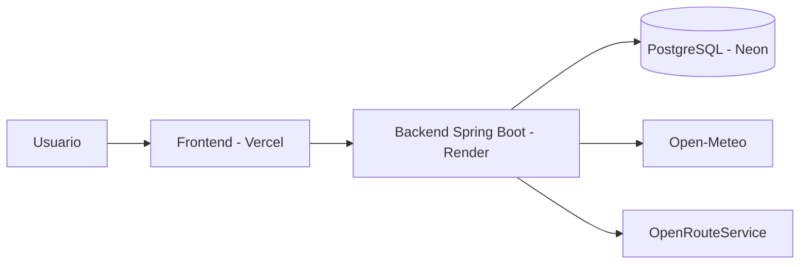

# ViaSeca-Proyectos-Interdisciplinarios-3

# VíaSeca

**App colaborativa de monitoreo y rutas seguras frente a inundaciones del Fenómeno de El Niño en zonas vulnerables de Chiclayo.**

Proyecto del curso *Proyectos Interdisciplinarios 3* — Universidad de Ingeniería y Tecnología (UTEC).

| | |
|---|---|
| **Aplicación** | [ENLACE DE VERCEL] |
| **API** | https://viaseca-proyectos-interdisciplinarios-3.onrender.com |
| **Documentación de la API (Swagger)** | https://viaseca-proyectos-interdisciplinarios-3.onrender.com/swagger-ui.html |

> El servidor gratuito se duerme tras 15 minutos sin uso. El primer acceso después de ese tiempo puede tardar cerca de 2 minutos en responder.

## El problema

Durante las lluvias del Fenómeno de El Niño, Chiclayo sufre inundaciones por la ausencia de un drenaje pluvial eficiente. Los vecinos dependen de grupos de WhatsApp saturados y de reportes oficiales que llegan tarde, lo que genera incertidumbre y riesgo al movilizarse. Como la infraestructura pluvial excede el alcance de un proyecto de curso, VíaSeca se enfoca en la **información**: avisar a tiempo, validar lo que reporta la comunidad y proponer rutas más seguras.

Alineado con los ODS **11.5**, **13.1** y **13.3**.

## Qué hace

- **Mapa de riesgo** con reportes ciudadanos en cuatro niveles: vía libre, charcos, inundación media e intransitable.
- **Reportes con foto**, ubicación y nivel de agua, sin mostrar la identidad de quien reporta.
- **Validación comunitaria:** los vecinos confirman o desmienten cada reporte.
- **Rutas seguras:** calcula un recorrido que esquiva las zonas inundadas reportadas.
- **Alerta temprana:**
  - Pronóstico de lluvias para las próximas 24 horas y 3 días, con cuatro niveles de aviso (sin avisos, vigilancia, precaución y alerta) y recomendaciones de seguridad.
  - Estado oficial del sistema de alerta de ENFEN y avisos oficiales.
  - Avisos emergentes dentro de la app cuando aparece o se confirma un reporte.
- **Centro de alertas** que reúne en un solo lugar los avisos oficiales y los de la comunidad.

## Filtros contra reportes falsos

| Filtro | Cómo funciona |
|---|---|
| Autenticación | Solo usuarios registrados pueden reportar y votar (JWT) |
| Consenso | Un reporte pasa a *Confirmado* con 3 confirmaciones de usuarios distintos |
| Cercanía | Para votar hay que estar a menos de 500 m del punto (configurable) |
| Precisión del GPS | Se rechazan reportes con precisión peor a 100 m |
| Límite de frecuencia | Máximo 5 reportes por hora por usuario |
| Cruce con el clima | Un reporte de inundación sin lluvia reciente en la zona se marca como *sospechoso* y necesita una confirmación más |
| Reputación | Sube cuando un reporte se confirma, baja cuando se rechaza, y la cuenta se suspende al llegar al umbral |
| Caducidad | Un reporte expira a las 2 horas si nadie lo reconfirma |
| Fotos | Solo JPG o PNG de hasta 10 MB, validados por el contenido del archivo y no por su nombre |

## Tecnologías

| Capa | Tecnología |
|---|---|
| Frontend | React, TypeScript, Vite, Tailwind CSS, Leaflet, React Router |
| Backend | Java 21, Spring Boot 4, Spring Security (JWT), Spring Data JPA, Flyway, springdoc (Swagger) |
| Base de datos | PostgreSQL |
| Despliegue | Vercel (frontend), Render (backend con Docker), Neon (PostgreSQL) |



## Estructura del repositorio

```
.
├── backend/                  API en Spring Boot
│   ├── src/main/java/com/viaseca/backend/
│   │   ├── domain/           Entidades
│   │   ├── repo/             Repositorios
│   │   ├── service/          Lógica de negocio y filtros
│   │   ├── security/         Autenticación y JWT
│   │   ├── web/              Controladores y DTOs
│   │   └── config/           Configuración
│   ├── src/main/resources/
│   │   ├── application.yaml
│   │   └── db/migration/     Migraciones de Flyway
│   └── Dockerfile
├── viaseca-frontend/viaseca/ Aplicación web en React
├── docker-compose.yml
└── .env.example
```

## Cómo ejecutarlo en tu computadora

**Requisitos:** JDK 21, Node.js 20 y Docker Desktop.

1. Copia `.env.example` como `.env` y completa los valores.
2. Levanta la base de datos:

```bash
docker compose up -d db
```

3. Ejecuta el backend desde IntelliJ IDEA (clase `BackendApplication`) o con Maven desde `backend/`:

```bash
mvn spring-boot:run
```

4. Ejecuta el frontend:

```bash
cd viaseca-frontend/viaseca
npm install
npm run dev
```

También puedes levantar la base y el backend en contenedores:

```bash
docker compose up -d --build
```

En ese caso no ejecutes el backend desde el IDE al mismo tiempo, porque ambos usan el puerto 8080.

## Variables de entorno

| Variable | Para qué sirve |
|---|---|
| `DB_URL`, `DB_USER`, `DB_PASSWORD` | Conexión a PostgreSQL |
| `JWT_SECRET` | Clave para firmar los tokens (32 caracteres o más) |
| `ORS_API_KEY` | Clave de OpenRouteService para calcular rutas |
| `RADIO_VOTO_METROS` | Distancia máxima para votar (500 por defecto) |
| `CORS_ORIGENES` | Orígenes permitidos para el frontend |
| `FOTOS_CARPETA` | Carpeta donde se guardan las fotos |
| `VITE_API_URL` | Dirección del backend (frontend) |

Nunca subas el archivo `.env` al repositorio.

## Endpoints principales

| Método | Ruta | Acceso |
|---|---|---|
| POST | `/auth/registro`, `/auth/login` | Público |
| GET | `/reportes` | Público |
| POST | `/reportes` | Con sesión |
| POST | `/reportes/{id}/votos` | Con sesión |
| POST | `/fotos` | Con sesión |
| GET | `/alertas`, `/mapa/resumen` | Público |
| GET | `/clima/pronostico` | Público |
| GET | `/rutas` | Con sesión |

## Datos y atribuciones

- Pronóstico meteorológico: [Open-Meteo.com](https://open-meteo.com), licencia CC BY 4.0.
- Mapas y datos de calles: © colaboradores de [OpenStreetMap](https://www.openstreetmap.org/copyright).
- Cálculo de rutas: [OpenRouteService](https://openrouteservice.org).
- Estado de alerta de El Niño Costero: comunicados oficiales de [ENFEN](https://www.gob.pe/institucion/senamhi/colecciones/1308-comunicados-enfen).

## Alcance y limitaciones

VíaSeca es un **prototipo académico**, y conviene ser claros con lo que es real y lo que no:

- No existe una API pública oficial de ENFEN, SENAMHI ni INDECI. El estado de ENFEN y los avisos oficiales se **cargan manualmente** desde los comunicados.
- Los umbrales de los niveles de aviso de lluvia son **referenciales**, no son los oficiales. Siempre hay que seguir los comunicados de SENAMHI, ENFEN e INDECI.
- Los avisos emergentes funcionan **solo con la aplicación abierta**. No hay notificaciones push.
- En la demostración desplegada, el filtro de cercanía al votar está relajado, porque el equipo no se encuentra en Chiclayo.
- El hosting gratuito no conserva las fotos subidas cuando el servidor se reinicia, y el backend se duerme tras un tiempo sin uso.
- No hay datos de nivel de agua ni de caudal de ríos medidos por sensores.
- Las alertas oficiales cargadas con la base de datos son de demostración.

## Equipo

| Integrante |
|---|
| Adrian Rojas |
| Matias Alvarez L. |
| Sergio Edu Bautista P. |
| Nestor Alonso De La Cruz Gomez |

**Profesor:** Jorge Gonzales Balladares · **Universidad de Ingeniería y Tecnología (UTEC)** · Lima, Perú

## Licencia

Proyecto académico con fines educativos. [Define aquí la licencia si deseas publicar el código bajo una.]
